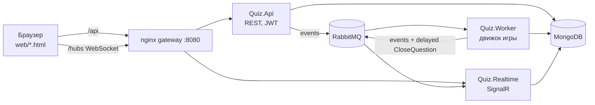

# QuizProject — квиз-платформа в реальном времени

Ведущий создаёт викторину, запускает игру и получает PIN. Игроки заходят по PIN с телефона, вводят никнейм и
отвечают на скорость. Чем быстрее правильный ответ, тем больше очков. После каждого вопроса показывается таблица
лидеров, в конце подиум.

Проект курса «Бэкенд-разработка от Контура»: ASP.NET Core 10, MongoDB, RabbitMQ + MassTransit, SignalR, Docker.
Требования и заметки лежат в [docs/](docs/).

## Архитектура



| Сервис | Что делает |
|---|---|
| **Quiz.Api** | Регистрация и логин ведущих (JWT), CRUD викторин, создание игры и PIN, вход игроков (токен сессии), приём ответов с серверным временем. Всё, что меняет игру, публикует в RabbitMQ. |
| **Quiz.Worker** | Конечный автомат игры: открыть вопрос → таймер (отложенное сообщение) → закрыть → посчитать очки → лидерборд → следующий вопрос → итоги. Lease-блокировки, идемпотентность, фоновое восстановление зависших и закрытие брошенных игр. |
| **Quiz.Realtime** | SignalR-хаб `/hubs/game`, группы по `gameId`. Слушает события из RabbitMQ и рассылает клиентам игры. Отдельная группа ведущего (прогресс ответов). |

Общие проекты:

| Проект | Содержимое |
|---|---|
| `Quiz.Contracts` | Контракты сообщений (события и команды) — граница между сервисами. |
| `Quiz.Domain` | Сущности и чистая бизнес-логика: подсчёт очков, правила приёма ответа, PIN, валидация викторины, лидерборд. |
| `Quiz.Infrastructure` | Mongo (маппинг, индексы, health), MassTransit (retry, DLQ, delayed scheduler), JWT, Serilog, health endpoints. |

### Путь события (основной сценарий)

```
Ведущий жмёт «Старт»
  → API: Lobby → Running (условный апдейт), publish GameStarted
  → Worker: lease, вопрос 0 → Open, publish QuestionStarted, schedule CloseQuestion(+timeLimit)
  → Realtime: QuestionStarted всем в группе игры (без правильного ответа)

Игрок отвечает: POST /api/games/{id}/answers
  → API: проверка по серверному времени, insert (уникальный индекс = нельзя ответить дважды),
         publish AnswerSubmitted
  → Realtime: ведущему «ответили 12/30»
  → Worker: если ответили все — закрывает вопрос досрочно

Таймер истёк (отложенное сообщение CloseQuestion)
  → Worker: lease, очки за ответы (Set), пересчёт суммы игроков, Open → Closed,
            publish QuestionClosed + LeaderboardUpdated
  → Realtime: правильный ответ, распределение ответов, таблица лидеров

Ведущий жмёт «Далее»: API publish AdvanceGame(expectedIndex) → Worker: следующий вопрос или GameFinished
```

### Надёжность

- **Таймеры** — отложенные сообщения RabbitMQ (плагин `rabbitmq_delayed_message_exchange`). Таймер живёт в брокере,
  а не в памяти воркера, поэтому переживает рестарт воркера.
- **Lease**: перед каждым шагом воркер захватывает игру (`leaseOwner`, `leaseUntil` в `games`) условным апдейтом.
  Параллельные обработчики одной игры получают `LeaseBusyException` и уходят в retry. Если воркер упал,
  lease истекает через `Worker:LeaseTtl`.
- **Идемпотентность**: каждый переход — compare-and-set по `(currentQuestionIndex, phase)`. Повторный
  `CloseQuestion` или двойной клик «Далее» ничего не меняют. Очки пишутся через `Set` и пересчитываются суммой, а не
  через `Inc`, поэтому повторный подсчёт даёт тот же результат.
- **Восстановление**: `MaintenanceService` раз в 10 с ищет вопросы, открытые дольше дедлайна, и запущенные игры без
  первого вопроса, и доводит их. Игры без активности больше часа помечает `Abandoned`.
- **Retry + DLQ**: экспоненциальный retry (5 попыток, 200 мс → 10 с), затем сообщение уходит в `<queue>_error`.
  `PoisonMessageException` (например, `CloseQuestion` для несуществующей игры) уходит в `_error` без ретраев.
- **Честность и античит**: время ответа фиксирует сервер. Ответ после дедлайна отклоняется. Правильный ответ не
  уходит клиентам до `QuestionClosed`.

## Запуск

Нужны Docker и (для разработки) .NET SDK 10.

```bash
make up          # = cp .env.example .env (если нет) + docker compose up -d --build
python3 scripts/smoke.py   # прогон основного сценария через REST
```

| Адрес | Что |
|---|---|
| http://localhost:8080 | Фронт: `host.html` — ведущий, `play.html` — игрок |
| http://localhost:8080/docs | Документация API (Scalar / OpenAPI) |
| http://localhost:15672 | RabbitMQ management (логин и пароль из `.env`) |
| `mongodb://localhost:27018` | MongoDB (27018, чтобы не конфликтовать с локальным mongo) |

Разработка из IDE: `make infra` поднимает только Mongo и RabbitMQ, а сервисы запускаются с профилем `http`
(API :5100, Worker :5200, Realtime :5300). Настройки для разработки лежат в `appsettings.Development.json`.

Другие команды: `make test`, `make logs`, `make down`, `make clean` (с удалением данных).

### Конфигурация (env)

| Переменная | Описание |
|---|---|
| `Mongo__ConnectionString`, `Mongo__Database` | MongoDB |
| `RabbitMq__Host`, `RabbitMq__Username`, `RabbitMq__Password` | RabbitMQ |
| `Jwt__Key` | Ключ подписи JWT (от 32 байт). **Только из секретов, не в репозитории.** |
| `Worker__LeaseTtl`, `Worker__CloseGrace`, `Worker__MaintenanceInterval`, `Worker__StuckAfter`, `Worker__AbandonAfter` | Тайминги воркера |
| `Logging__Json` | `true` — логи в JSON (по умолчанию вне Development) |

Секреты (`JWT_KEY`, `RABBITMQ_*`) лежат в `.env`, а он в `.gitignore`. Шаблон — `.env.example`.

Каждый сервис слушает `0.0.0.0:80` внутри контейнера и отдаёт `/health/live` (процесс жив) и `/health/ready`
(Mongo и RabbitMQ доступны).

## REST API

| Метод | Путь | Кто | Описание |
|---|---|---|---|
| POST | `/api/auth/register` | — | Регистрация ведущего → JWT |
| POST | `/api/auth/login` | — | Вход ведущего → JWT |
| GET/POST | `/api/quizzes` | ведущий | Список / создание викторины |
| GET/PUT/DELETE | `/api/quizzes/{id}` | ведущий | Викторина |
| POST | `/api/games` | ведущий | Создать игру по викторине → `{gameId, pin}` |
| GET | `/api/games` | ведущий | История игр |
| GET | `/api/games/{id}` | ведущий / игрок | Состояние игры (для переподключения) |
| POST | `/api/games/{id}/start` | ведущий | Lobby → Running |
| POST | `/api/games/{id}/next` | ведущий | Следующий вопрос (если текущий открыт — закрыть досрочно) |
| POST | `/api/games/join` | — | Вход игрока `{pin, nickname}` → токен игрока |
| POST | `/api/games/{id}/answers` | игрок | `{questionIndex, optionIndex}` |
| GET | `/api/games/{id}/leaderboard` | ведущий / игрок | Таблица лидеров |

Ошибки отдаются в формате ProblemDetails (RFC 9457) через глобальный `GlobalExceptionHandler`.
У каждого ответа есть заголовок `X-Correlation-Id`.

## SignalR (`/hubs/game`)

Подключение с JWT (`?access_token=`), затем `JoinGame(gameId)`. Сервер вызывает у клиента:

| Метод | Кому | Когда |
|---|---|---|
| `PlayerJoined` | все | игрок зашёл в лобби |
| `GameStarted` | все | старт игры |
| `QuestionStarted` | все | новый вопрос (без правильного ответа) |
| `AnswerProgress` | только ведущий | ответили N из M |
| `QuestionClosed` | все | правильный ответ и распределение ответов |
| `LeaderboardUpdated` | все | таблица лидеров после вопроса |
| `GameFinished` | все | итоги |

## Топология RabbitMQ

MassTransit создаёт fanout exchange на каждый тип сообщения (`Quiz.Contracts.Events:QuestionStarted` и т.д.).
У каждого сервиса свои очереди с префиксом (`worker-`, `realtime-`), поэтому каждый сервис получает свою копию события.

| Сообщение | Тип | Публикует | Очереди-подписчики |
|---|---|---|---|
| `PlayerJoined` | событие | API | `realtime-game-events-broadcaster` |
| `GameStarted` | событие | API | `worker-game-started`, `realtime-game-events-broadcaster` |
| `AnswerSubmitted` | событие | API | `worker-answer-submitted`, `realtime-game-events-broadcaster` |
| `QuestionStarted` | событие | Worker | `realtime-game-events-broadcaster` |
| `QuestionClosed` | событие | Worker | `realtime-game-events-broadcaster` |
| `LeaderboardUpdated` | событие | Worker | `realtime-game-events-broadcaster` |
| `GameFinished` | событие | Worker | `realtime-game-events-broadcaster` |
| `CloseQuestion` | команда, **отложенная** | Worker (таймер), API (досрочно) | `worker-close-question` |
| `AdvanceGame` | команда | API | `worker-advance-game` |

Ошибки: у каждой очереди есть `<queue>_error` (DLQ) и `<queue>_skipped`.

## MongoDB

| Коллекция | Что хранит | Индексы |
|---|---|---|
| `users` | ведущие: логин, хэш пароля | `ux_login` (уникальный) |
| `quizzes` | владелец, название, вопросы (вложенный массив) | `ix_owner_updated` {ownerId, updatedAt↓} |
| `games` | снимок вопросов, PIN, статус, фаза и дедлайн вопроса, `leaseOwner/leaseUntil/attempts/lastUpdated` | `ux_pin_active` — уникальный PIN **среди активных** (partial `isActive: true`); `ix_status_lease` — поиск зависших; `ix_host_created` — история |
| `players` | gameId, никнейм, счёт | `ux_game_nickname` {gameId, nicknameKey} (уникальный) |
| `answers` | gameId, вопрос, игрок, вариант, серверное время, очки | `ux_game_question_player` (уникальный): идемпотентность ответа на уровне БД |
| `game_events` | журнал событий игры | `ix_game_at` |

Индексы создаются при старте сервисов (`MongoIndexInitializer`, операция идемпотентна).

## Структура репозитория

```
src/
  Quiz.Contracts/        контракты сообщений
  Quiz.Domain/           сущности + бизнес-правила
  Quiz.Infrastructure/   Mongo, MassTransit, JWT, логи, health
  Quiz.Api/              WebAPI (+ Dockerfile)
  Quiz.Worker/           движок игры (+ Dockerfile)
  Quiz.Realtime/         SignalR (+ Dockerfile)
tests/Quiz.UnitTests/    unit-тесты доменной логики
web/                     минимальный фронт (HTML + JS + SignalR client)
deploy/                  nginx, RabbitMQ с delayed-плагином (позже — k8s-манифесты)
scripts/smoke.py         e2e smoke основного сценария
docs/                    требования курса и заметки по проекту
```

## Статус по спринтам

- [x] **Спринт 1** — тема, роли.
- [x] **Спринт 2** — основной сценарий работает end-to-end, есть WebAPI, 3 сервиса в Docker, CI (build, lint, test, docker build).
- [ ] **Спринт 3** — OpenTelemetry → Jaeger, Prometheus `/metrics` (`active_games_total`, `answers_submitted_total`,
  `question_close_lag_seconds`, `tasks_pending_total`), ELK, k8s-манифесты и деплой в minikube, интеграционные тесты
  (Testcontainers: REST, Mongo, consumer'ы), статистика по вопросам, rate limiting на ответы.
- [ ] **Спринт 4** — отчёт автору викторины, картинки к вопросам (MinIO), transactional outbox, полировка.
